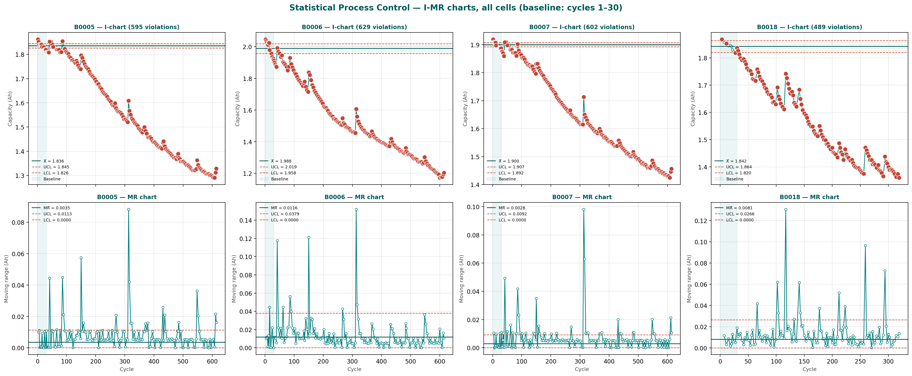

# Battery Cycling Quality Analytics

A DMAIC Six Sigma pipeline for battery cycling data — validated on NASA PCoE lithium-ion cycling, with methodology designed to transfer to long-duration iron-air storage quality control.

**Author:** Bhargava Sriram P · BITS Pilani Hyderabad (ME, Aug 2027) · Six Sigma Green Belt
**Target roles:** Quality Engineer I & Battery Engineer I, battery manufacturing

---

## Project status

| DMAIC Phase | Deliverable | Notebook | Report |
|---|---|---|---|
| Define | Project Charter, CTQ Tree, SIPOC | [00](notebooks/00_dmaic_charter.ipynb) | [Charter PDF](outputs/charts/00_project_charter.pdf) |
| Measure | NASA .mat parse → long-format Parquet | [01](notebooks/01_load_nasa.ipynb) · [02](notebooks/02_parse_struct.ipynb) | — |
| Measure | Discharge voltage curves (B0005 life) | [03](notebooks/03_discharge_curves.ipynb) | — |
| Measure | Per-cycle capacity via trapezoidal integration + fade curves | [04](notebooks/04_capacity_fade.ipynb) | — |
| Measure | Linear + exponential fade model fits + RUL predictions | [05](notebooks/05_fade_rate.ipynb) | — |
| Measure | **MSA — Type 1 Gauge Study + Bland-Altman** | [02b](notebooks/02b_msa.ipynb) | [MSA PDF](outputs/charts/02b_msa_report.pdf) |
| Analyze | **SPC — I-MR + X-bar/R + Western Electric Rules** | [06](notebooks/06_spc.ipynb) | [SPC PDF](outputs/charts/06_spc_report.pdf) |
| Analyze | Pareto + Fishbone | 07 (in progress) | — |
| Analyze | ANOVA (fade rate differences across cells) | 08 | — |
| Improve | 2² Design of Experiments | 09 | — |
| Control | Cp/Cpk capability study | 10 | — |
| Control | Weibull reliability (β, η) | 11 | — |
| Control | Control plan | 12 | — |

### SPC I-MR control charts (all 4 cells, baseline cycles 1–30)

---

## What this project does

Takes raw cell-cycling data from the [NASA PCoE Battery Prognostics Dataset](https://www.nasa.gov/intelligent-systems-division/discovery-and-systems-health/pcoe/pcoe-data-set-repository/) and runs it through a Six Sigma Quality Engineering pipeline:

1. **Define** — DMAIC Project Charter, Critical-to-Quality (CTQ) Tree, SIPOC diagram.
2. **Measure** — Parse NASA's nested MATLAB struct into tidy long-format Parquet. Visualize discharge voltage curves across cell life. Compute per-cycle capacity two ways (NASA-reported vs. first-principles integration) and validate agreement to under 1% via Measurement System Analysis.
3. **Analyze** — Fit linear and exponential degradation models per cell; predict Remaining Useful Life. Build Statistical Process Control charts (I-MR individuals and X-bar/R subgroups) with baseline control limits computed from early-life cycles and all 4 Western Electric rules applied.

**Current status:** Define, Measure, and the SPC stage of Analyze are complete. Pareto/Fishbone, ANOVA, Design of Experiments, Cp/Cpk capability, Weibull reliability, and control plan are the remaining phases, scheduled through January 2027.
